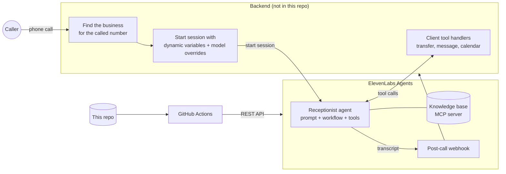
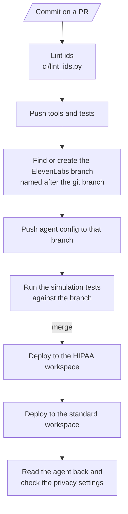

# ElevenLabs Multi-Tenant Receptionist

A phone receptionist built on ElevenLabs Agents where one agent answers for many different businesses, and where the whole agent (prompt, workflow, tools, tests) lives in git and is deployed by CI instead of being edited in the ElevenLabs UI.

I built and ran this setup for a production AI receptionist product. This repo is a generic version of it: the CI code is the real thing, the agent, tools and tests were rewritten with made-up businesses, and every ElevenLabs id is a placeholder.

---

## What it does

A call comes in for a business. The backend looks up which business owns that number and starts an ElevenLabs session, passing that business's name, opening hours, transfer rules and calendars as dynamic variables. The agent config itself knows nothing about any specific business, so adding a customer never means touching the agent.

Changes to the agent go through pull requests. For each PR, CI creates an ElevenLabs branch of the agent with the same name as the git branch, pushes the config there, and runs simulated phone calls against it. Merging pushes the config to the live agent.

The same config is deployed to two ElevenLabs workspaces: a normal one and a zero-retention one for HIPAA customers.

---

## Architecture



The backend and the telephony side are not part of this repo. What they need to know is all here: which variables to send, which client tools to implement and which overrides the agent accepts.

### One agent, many businesses

Each call starts with something like this:

```json
{
  "dynamic_variables": {
    "business_name": "Harbor Dental",
    "first_message": "Hi, you've reached Harbor Dental. How can I help you today?",
    "business_hours": "Monday: 9:00 AM to 5:00 PM; ...",
    "within_business_hours": "true",
    "current_datetime": "Tuesday, June 23 2026, 2:00 PM",
    "transfer_enabled": "true",
    "transfer_rules": "[{\"match\": \"...\", \"destination\": \"...\", \"announce\": \"...\"}]",
    "scheduling_enabled": "false",
    "scheduling_calendars": "[]",
    "global_context": "Family dental clinic. Dr. Chen sees patients Mon-Fri."
  }
}
```

`transfer_enabled` and `scheduling_enabled` switch whole features on and off per business. `current_datetime` is always sent by the backend. The agent never reads the real clock, otherwise a test about "tomorrow" passes or fails depending on the day CI runs.

The backend can also override the LLM and the TTS model per call (`platform_settings.overrides`). That is how I roll a new model out to a percentage of customers without redeploying the agent. The defaults in the config are `claude-haiku-5-5` and `eleven_v4_turbo`.

### Workflow

```
start → Reception & Triage ─┬→ Call Transfer ────────┐
              ↑             ├→ Schedule Appointment ─┤
              └─────────────┴────────────────────────┘
                            └→ end
```

The base prompt holds what is true in every stage: how to talk on the phone, what the agent knows about the business, how to take a message. Each workflow node adds its own step-by-step procedures (`additional_prompt`) and its own tools (`additional_tool_ids`), so the booking tools only exist inside the scheduling node.

The edges out of triage check two things: the feature flag for that business (`scheduling_enabled == "true"`) and an LLM condition about what the caller wants. If scheduling is off for a business, the agent cannot reach the booking node no matter what the caller says. The same edge carries a backward condition that sends the call back to triage when the booking or the transfer is over. Only triage can end the call.

### CI on every PR



Only the agent config is branch scoped. Tools and tests are global in an ElevenLabs workspace, so editing a tool in a PR changes it for the live agent too.

All pushes use the REST API directly. The official CLI is fine for pulling, but when pushing it drops `response_mocks` from tools, fails on some agent payloads with a 422, and cannot run tests against a branch.

### Two workspaces

ElevenLabs ids (agents, tools, tests, MCP servers, webhooks) are different in every workspace. The JSON in this repo always carries the ids of the `standard` workspace, and `workspaces.json` maps each one to its id in the other workspace. Pushing to `standard` changes nothing in the files. Pushing to `hipaa` swaps the ids, applies the privacy settings (zero retention, no recording) and removes what that workspace cannot have: an MCP server cannot be attached to a zero-retention workspace, so the knowledge search part of the prompt is removed there and the test that depends on it is skipped, with the reason printed in the log.

The id swap walks the JSON by field name instead of using a regex. `agent_response` is an ElevenLabs event name and a pattern like `agent_\w+` would have rewritten it. Some ids are also object keys (`tool_mock_overrides`), which a find and replace on values would miss.

HIPAA is deployed first. If it fails, production has not been touched yet.

### Flaky tests

The simulation tests are an LLM playing the caller and another LLM judging the transcript, so they fail randomly some of the time. On the production suite (23 tests) I measured about 10% of tests failing on a first run with nothing actually broken. With a rule like "retry once" that made roughly one build in five red for no reason, and people stopped reading the check. Those numbers are from that suite, not from the 5 tests in this repo.

What the pipeline does now:

- A test only counts as failed when the judge gave a real "failed" verdict. Timeouts and "inconclusive" are retried and do not count.
- A test fails the build after 4 real failures. The real bugs I hit failed every single time, so they still get caught.
- `ci/test_stability.py` prints pass/fail per test over the last CI runs, to tell a broken test from a noisy one.

---

## Stack

| Layer | Technology |
|-------|------------|
| Voice agent | ElevenLabs Agents (workflow, client tools, simulation tests, branches) |
| LLM | `claude-haiku-5-5`, overridable per call |
| TTS | `eleven_v4_turbo`, overridable per call |
| CI/CD | GitHub Actions |
| Pipeline code | Python 3, standard library only |
| Config checks | `jq`, `unittest` |

---

## Project structure

```
workspaces.json                  — Workspaces, which agent ships where, id mapping table
agents.json                      — Index used by the ElevenLabs CLI for `agents pull`
agents/receptionist/
└── receptionist.json            — Agent config: base prompt, workflow nodes and edges, overrides
tools/
├── transfer_call.json           — Client tools. Each one has response_mocks,
├── take_message.json              used only during simulation tests
├── check_availability.json
└── book_appointment.json
tests/                           — Simulation tests, each one a different made-up business
ci/
├── push_workspace.py            — Entry point for CI and deploy: pushes one workspace, runs the tests
├── lint_ids.py                  — Fails if an id has no counterpart in the other workspace
├── assert_node_models.py        — Fails if a workflow node sets its own LLM or TTS model
├── assert_privacy.py            — After deploy: reads the agent back and checks privacy settings
├── test_stability.py            — Pass/fail per test across recent CI runs
├── lib/
│   ├── refs.py                  — Which JSON fields hold ids
│   ├── translate.py             — Id swap, privacy overlay, removal of unsupported features
│   └── push.py                  — REST calls, retries, test polling
└── tests/test_translate.py      — Unit tests for the id translation
.github/workflows/
├── ci.yml                       — On PR: validate, push to a branch, run the tests
├── deploy.yml                   — On merge: deploy each workspace in order
└── cleanup.yml                  — Tries to delete the PR branch (see Known issues)
```

---

## Setup

The ids in this repo are placeholders, so you need your own ElevenLabs workspace.

### 1. Create the resources

Create the agent, the four tools and the tests in ElevenLabs. The JSON files here can be used as the request bodies.

### 2. Put your ids in the repo

Easiest is to pull them with the CLI:

```bash
npx @elevenlabs/cli agents pull --agent <your_agent_id> --output-dir agents
npx @elevenlabs/cli tools pull
npx @elevenlabs/cli tests pull --all --output-dir tests
```

Then update `workspaces.json` with the same ids. If you only have one workspace, delete the `hipaa` entry and take it out of `deploy_to` and `deploy_order`.

### 3. Check it locally

```bash
python3 ci/tests/test_translate.py
python3 ci/lint_ids.py --workspace standard
python3 ci/assert_node_models.py
```

### 4. Run the pipeline

```bash
ELEVENLABS_API_KEY=... python3 ci/push_workspace.py \
  --workspace standard --mode ci --branch-name "$(git rev-parse --abbrev-ref HEAD)"
```

This is the same command CI runs. For GitHub Actions, add `ELEVENLABS_API_KEY` (and `ELEVENLABS_API_KEY_HIPAA` if you use the second workspace) as repository secrets, and set the repository variable `ELEVENLABS_ENABLED` to `true`. Until that variable is set, CI only runs the lints and unit tests and never calls ElevenLabs.

---

## Known issues

- **PR branches are never deleted.** `DELETE /v1/convai/agents/{id}/branches/{branch_id}` returns 405. Do not try `DELETE /v1/convai/agents/{id}?branch_id=...` instead: it ignores the branch and deletes the whole agent. I found that out in production. Branches have to be cleaned up by hand in the UI.
- **The knowledge test needs a real MCP server.** The agent expects an MCP server that exposes a tool called `search_knowledge`. The id in this repo is a placeholder and MCP tools cannot be mocked like client tools, so `Knowledge — Searches Before Answering` only means something once you attach your own server.
- **Tools and tests are not isolated per PR.** They are workspace global, so a PR that edits a tool changes it for the live agent as soon as CI runs.

More detail on the pipeline in [ci/README.md](ci/README.md).

---

## License

MIT
