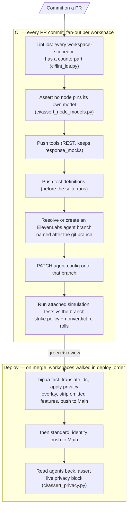

# ElevenLabs Multi-Tenant Receptionist — Agents as Code

A production-grade pattern for running **one ElevenLabs Conversational AI agent as a shared
platform serving many businesses**, with the entire agent lifecycle — prompts, tools, tests,
deploys — managed from a git repository instead of the ElevenLabs UI.

This repo distills the architecture I built and operated for a commercial AI receptionist
platform (thousands of real phone calls), rebuilt here with generic content and placeholder
ids so the pattern itself is the artifact.

## What this demonstrates

- **Multi-tenancy without config duplication** — one agent, one prompt; each business gets its
  own behavior through `dynamic_variables` injected at call time.
- **Agents as code** — every prompt, tool definition, and simulation test is versioned JSON;
  nothing is edited in the UI. CI pushes to an ElevenLabs *agent branch* per PR, runs the
  simulation suite against it, and deploys to each workspace's Main branch on merge.
- **Multi-workspace deploys with id translation** — the same config ships to a standard
  workspace and a zero-retention (HIPAA) workspace. Workspace-scoped ids are substituted from
  a registry at push time; a config overlay enforces the privacy block; features a workspace
  cannot hold (MCP servers, webhooks) are stripped and their tests skipped *by name and
  reason, never silently*.
- **LLM-judged tests treated as a statistics problem** — simulation tests are noisy by
  construction, so the pipeline distinguishes `failed` from `nonverdict`, re-rolls
  non-verdicts for free, and fails the build only after a measured strike threshold.
- **Working around real API/CLI sharp edges** — pushes go through the REST API because the
  official CLI drops `response_mocks` and mis-serializes some payloads; branch deletion is
  deliberately left broken because the "obvious fix" deletes the whole agent (verified the
  hard way).

## How multi-tenancy works

The agent config is tenant-agnostic. At session start, the telephony backend resolves the
called number to a business and opens the conversation with that tenant's variables:

```jsonc
{
  "dynamic_variables": {
    "business_name": "Harbor Dental",
    "first_message": "Hi, you've reached Harbor Dental. How can I help you today?",
    "business_hours": "Monday: 9:00 AM to 5:00 PM; ...",
    "within_business_hours": "true",
    "current_datetime": "Tuesday, June 23 2026, 2:00 PM",   // pinned — the agent never reads a wall clock
    "transfer_enabled": "true",
    "transfer_rules": "[{\"match\": \"...\", \"destination\": \"...\", \"announce\": \"...\"}]",
    "scheduling_enabled": "false",
    "scheduling_calendars": "[]",
    "global_context": "Family dental clinic. Dr. Chen sees patients Mon-Fri."
  }
}
```

The prompt (`agents/receptionist/receptionist.json`) treats each capability as a **hard
gate**: a disabled capability does not exist on that call. The simulation tests exercise the
same mechanism — each test file injects a different fictional tenant (a dental clinic, a yoga
studio, a law firm, a bakery) and asserts the platform behaves correctly *for that tenant
type*. A test failure means the shared platform broke for a class of tenant, not that one
business's config is wrong.

Per-conversation **client overrides** (`tts.model_id`, `agent.prompt.llm`, `tts.stability`,
`tts.similarity_boost`) are enabled in `platform_settings.overrides`, so the backend can run
model experiments per call without a redeploy — e.g. an A/B arm on a new LLM. A rule this
enables: no workflow node may pin its own `llm` or `tts.model_id`, because a node-level value
silently beats the override (`ci/assert_node_models.py` enforces it on every PR).

## Pipeline



HIPAA deploys **first** on purpose: a failure there leaves production untouched, while a
standard-first failure would leave the HIPAA workspace stale after production had already
moved.

## The workspace registry

`workspaces.json` is the single source of truth: which workspaces exist, which agents ship to
each (`deploy_to`), the deploy order, and a translation table mapping every workspace-scoped
id (agents, tools, tests, MCP servers, webhooks) from the reference workspace to its
counterpart elsewhere. Three invariants:

1. The versioned JSON always holds the **reference workspace's** ids. Pushing there is the
   identity function — the repo cannot corrupt the workspace carrying real traffic.
2. Ids are located **by position, never by shape**. A regex sweep for `agent_[a-z0-9]+`
   would match `agent_response` — a client-event name — and corrupt it; and only a
   position walk can reach ids that appear as object *keys* (`tool_mock_overrides`).
3. The registry may name an environment variable; it may **never hold a key value**
   (linted on every run).

## Testing philosophy

Simulation tests are LLM conversations judged by an LLM. One run proves nothing, so the
pipeline encodes what a red check is allowed to mean:

| Verdict | Meaning | Counts as a strike? |
|---|---|---|
| `passed` | every success condition met | — |
| `failed` | the judge evaluated and the agent got it wrong | yes |
| `nonverdict` | the judge produced no answer (timeout, API error, inconclusive) | no — re-rolled free |

A test fails the build after **4 real `failed` verdicts** — a measured threshold, not a
taste: at the suite's observed ~10% per-test round-0 failure rate, 2 strikes produce a false
red roughly one run in five, 4 strikes one in five hundred, while every genuine defect
observed failed on *every* attempt and still strikes out. `ci/test_stability.py` re-measures
the noise floor across recent runs before anyone tunes the threshold.

Tests that exercise a feature a workspace deliberately omits (e.g. knowledge-base search via
MCP in the zero-retention workspace) declare it with `requires` in the registry and are
skipped there — logged by name and reason, because a silent skip and a permanently red test
are both ways a check stops meaning anything.

## Why REST instead of the official CLI (push direction)

| CLI command | Issue | Used instead |
|---|---|---|
| `agents push` | serialization bug wraps LLM AST nodes → 422 | `PATCH /v1/convai/agents/{id}?branch_id=` |
| `tools push` | silently drops `response_mocks` | REST loop over `tools.json` |
| `agents test` | no `--branch` flag — always tests Main | `POST /run-tests` with `branch_id` |

Pull commands are fine and are how the repo syncs back from the reference workspace.

## Repo layout

```
workspaces.json        # workspace registry + id translation table (ids here are placeholders)
agents/receptionist/   # the multi-tenant agent config: prompt, variables, overrides, attached tests
tools/                 # tool definitions, each with response_mocks for simulation
tests/                 # simulation tests — one fictional tenant each
ci/
  push_workspace.py    # the driver CI and deploy both run, one workspace at a time
  lib/                 # refs (where ids live) / translate (id substitution + overlay) / push (REST)
  lint_ids.py          # every id has a counterpart in every workspace it ships to
  assert_node_models.py# no node may out-pin the per-conversation model overrides
  assert_privacy.py    # post-deploy read-back of the live privacy block
  test_stability.py    # measures suite flakiness across CI runs
  tests/               # unit tests for the translator (run first in CI)
.github/workflows/     # ci.yml (PR) / deploy.yml (merge) / cleanup.yml (see its comments)
```

## Running it yourself

All ids in this repo are placeholders. To point it at real workspaces:

1. Create an agent, the four tools, and the tests in your ElevenLabs workspace (the configs
   here are complete payloads — `POST /v1/convai/agents/create`, `/tools/create`,
   `/agent-testing/create`).
2. Write the resulting ids into `workspaces.json`, `tools.json` and the test files
   (`agents pull` / `tools pull` / `tests pull` from the official CLI do this for you).
3. Set the `ELEVENLABS_API_KEY` (and optionally `ELEVENLABS_API_KEY_HIPAA`) secrets, and the
   `DEPLOY_ENABLED=true` repository variable.
4. Open a PR — CI pushes everything to a per-PR agent branch and runs the suite:

```bash
# or locally, same driver CI runs:
ELEVENLABS_API_KEY=... python3 ci/push_workspace.py \
  --workspace standard --mode ci --branch-name "$(git rev-parse --abbrev-ref HEAD)"
```

`ci/README.md` documents the pipeline internals, the REST endpoints used, and the
operational lessons (including why branch cleanup is intentionally left broken).
